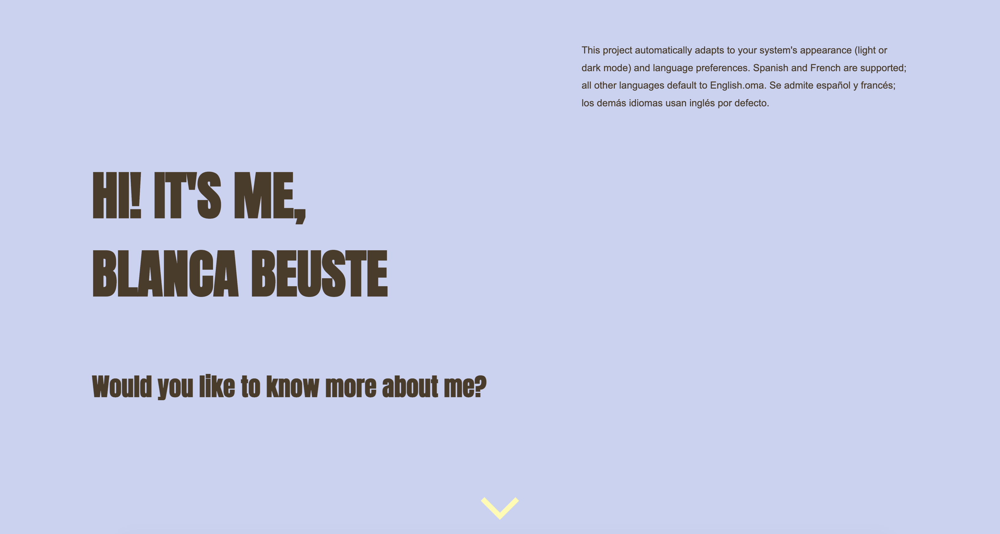

# Getting to know Blanca

**Two Truths and a Lie, but the topic is me.**

An interactive personal page where you get to know me by playing. Each block has three statements about me: two are true and one is a lie. Spot the lie, find out the story behind it, and stay for the bonus question at the end.

🔗 **[Play it here](https://blancabech.github.io/get-to-know-me/)**



## Features

- **Two Truths and a Lie game.** Pick the statement you think is false. The correct answer is highlighted either way, and an explanation appears without shifting the layout.
- **Automatic language detection.** The page reads the browser's language preferences and shows English, Spanish or French. Any other language falls back to English. There's no language selector because the page picks it for you, and it also updates if the browser language changes while the page is open.
- **Light and dark mode.** Colors adapt to the system theme through `prefers-color-scheme` and CSS custom properties.
- **Curtain scroll effect.** The cover slides up to reveal the game, which is already waiting underneath. This is done with CSS only, using `position: sticky`.
- **Typewriter intro.** The intro text types itself out, and its space is reserved in advance so nothing below it moves.
- **A bonus question with a twist.** One of the answers doesn't want to be clicked, on desktop or on mobile.
- **Responsive.** Designed for desktop, tablet and mobile.

## Built with

- HTML5
- CSS3: Flexbox, Grid, custom properties, media queries, animations
- JavaScript: no frameworks, libraries or build step

The site is fully static, so it runs on GitHub Pages and also works by opening `index.html` directly in a browser.

## Project structure

```
get-to-know-me/
├── index.html          # cover and first block
├── question2and3.html  # second and third block
├── bonus.html          # bonus question
├── css/
│   ├── tokens.css      # colors, fonts, light and dark themes
│   ├── main.css        # layout and components
│   └── fonts/
├── js/
│   ├── i18n.js         # language detection and translation
│   ├── textEffects.js  # typewriter effect
│   ├── game.js         # answer logic
│   └── final.js        # bonus question
└── lang/
    ├── en.js
    ├── es.js
    └── fr.js

```

## Run it locally

```bash
git clone https://github.com/blancabech/get-to-know-me.git
```

Then open `index.html` in your browser. That's all you need.